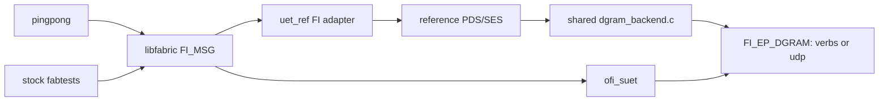

# SUET / reference interoperability through libfabric DGRAM

Ping-pong and performance tests use the **same loadable `uet_ref` provider**,
with the same [dgram_backend.c](dgram_backend.c), packet format, queues and
completion code. `UET_DGRAM_PROVIDER=verbs` or `udp` selects the underlying
libfabric `FI_EP_DGRAM` provider. The former custom UDP socket adapter has
been removed. The application uses libfabric FI_MSG calls for both providers.
TCP exchanges endpoint identities and synchronization records; payload data
always uses DGRAM.



The DGRAM payload is unchanged **PDS/SES bytes**, matching native SUET.
The reference NIC API still expects an internal Ethernet/IP/entropy envelope;
the shared backend removes that envelope and its zero CRC trailer on TX,
then reconstructs it on RX. There is one mapping for both applications and
both transports, with no IP-frame benchmarking mode. The reference uses
`UET_BENCH_DISABLE_CRC=1`, supplied by the recorded reference patch, because
this DGRAM profile has no UET software-CRC trailer on the wire. Underlying
transport integrity checks remain. The original CRC-on/off IP-frame experiment
is preserved in [its archived report](udverbs/README-crc-experiment.md).

## Build on both roce machines

Use the isolated SUET install at `/root/suet-interop-20261104/native-gap/build`
(the branch's gap-NACK fix on top of `0a7b0241`, libfabric base `94f3b1ac`
plus its existing patches) and the reference export at `/root/suet-interop-20261103/ref` (`9effe362`). Copy this
source tree to `/root/suet-interop-20261104/dgram/source`, then run there:

```bash
ROOT=/root/suet-interop-20261103
UET_REF_SOURCE="$ROOT/ref" \
LIBFABRIC_SOURCE=/root/suet-interop-20261104/native-gap/libfabric \
LIBFABRIC_PREFIX=/root/suet-interop-20261104/native-gap/build \
INTEROP_BUILD=/root/suet-interop-20261104/dgram/build \
bash tests/interop/build.sh
```

To reproduce the native install from a clean checkout, run the repository's
normal builder in a fresh workspace first; it pins libfabric and applies the
required source-address/entropy patches:

```bash
export WORKDIR=/root/suet-interop-20261104/fresh
JOBS=8 bash build.sh
export LIBFABRIC_SOURCE="$WORKDIR/libfabric"
export LIBFABRIC_PREFIX="$WORKDIR/build"
# Use these values in place of the native-gap paths in the interop build.
# Pass --fabric "$LIBFABRIC_PREFIX" to run.py and udverbs/compare.py.
```

This builds both `build/pingpong` and `build/provider/libuet_ref-fi.so`.
The same `.so` is used by `fi_rdm_pingpong` and `fi_rdm_bw`; there is no
separate copy of the reference NIC or reference core in `pingpong`.
The builder configures a 4,000-byte reference payload maximum in an isolated
source copy and applies only [the CRC switch patch](udverbs/patches/0001-pds-benchmark-crc-switch.patch).
The reference protocol implementation otherwise remains at `9effe362`; no
reference reliability, NACK or ordering changes are applied.
The original reference export and previous benchmark installations are preserved.

## Run the two-node test matrix

The controller uses `ssh -J mkhalilov@blue.inf.ethz.ch root@roce00.cscs.ch`
and the equivalent command for roce01. Data addresses are `10.203.44.1` and
`10.203.44.2` on `ens785f0np0`. Both interfaces need their isolated test IPv4
addresses assigned and the RDMA links active for verbs testing.

```bash
python3 tests/interop/run.py --control-port 35300 \
  --output /tmp/dgram-interop
python3 tests/interop/run.py --sr 1 --pairs suet-ref,ref-suet \
  --sizes 16,4001,1048576 --control-port 35500 \
  --output /tmp/dgram-interop-sr
```

The default matrix covers verbs/UDP, ROD/RUD, all four server/client pairings
(`suet-suet`, `ref-ref`, `suet-ref`, `ref-suet`), ten rounds, and sizes
16, 1,024, 1,025, 4,000, 4,001, 65,537 and 1,048,576 bytes. `--sr 0` uses
SUET GBN; `--sr 1` selects SR. `--backends`, `--modes`, `--pairs`, `--sizes`
and `--rounds` narrow the matrix. `--server-host`, `--client-host` and the
corresponding `--server-ip` / `--client-ip` options reverse the physical direction.

The verbs profile uses the native 4 KiB UD limit, giving 4,000 application
bytes per request. SUET selects this with `FI_OFI_SUET_PAYLOAD_MTU=0`, and
the reference selects 4,000. UDP's provider limit is 1,472 bytes, so both
providers select a 1,024-byte application payload for UDP interoperability.
Thus each transport includes single-packet and multi-packet messages with
matching segmentation between providers.

Each client sends ping, the server validates it and sends pong, and the client
validates pong. Both print each operation. The entire byte pattern, message
length and round number are checked. Receives are posted before the peer can
send its next message. Endpoint addresses use opaque DGRAM address bytes;
only the out-of-band logical PID/RI/initiator fields are translated.

`summary.json` records commands, exits and pass counts. Packet capture is
disabled by default in both interoperability and performance tests. For a
small diagnostic run, add `--capture --sizes 16,4001 --rounds 3`; reference-side
captures under the printed remote directory contain exact DGRAM PDS/SES bytes.
Full text capture of large messages can stall progress and trigger retransmits.

```bash
python3 tests/interop/decode.py /path/to/server.packets --limit 20
```

## Performance and profiling

See [the shared-backend benchmark and profiling guide](udverbs/README.md).
Historical socket-UDP interoperability results remain in
[the legacy report](README-udp-legacy.md) and their existing result directories.

## Native gap-NACK correction

The shared UDP tests exposed incorrect native gap feedback. ROD now puts the
later offending PSN in `nack_psn`, the missing expected PSN in `payload`, and
copies the triggering request's RETX flag. RUD with GBN now sends Receiver
Inferred Loss (`0x1a`) for the missing PSN when it discards a later in-window
packet; a true out-of-window packet still gets `0x0b`. Repeated reports for the
same RUD gap are coalesced, and a failed NACK submission does not suppress the
next attempt. Retry limits are unchanged.

The wire regression tests cover both modes, PSN wrap, request RETX, real
out-of-window packets, duplicate gap reports and transport backpressure.
On both hosts the original implementation fails the new Expected_PSN assertion;
the corrected implementation passes the complete PDS/datagram test. See
[regression summaries and source/library hashes](results/native-gap-regression-20261104/).
Ten fully validated 1-MiB UDP RUD rounds now pass in
[both mixed roles with native GBN](results/native-gap-udp-rud-20261104/summary.json).
The reference ROD replay issue is reported in the performance report; its
protocol is not changed to work around that issue.

After this fix, basic fabtests
passed **35/35**. Three-run native UD bandwidth medians were **6,503.65 MB/s at
64 KiB** and **6,084.46 MB/s at 1 MiB**, using one endpoint/core, native 4-KiB
transport, window 64, and 10,000 warmups plus 10,000 measured iterations.
[Commands, exits and samples](udverbs/results/native-gap-bandwidth-20261104/runs.json)
are retained. The pre-fix 1-MiB profiling controls were 6,104.34 and 6,081.03 MB/s;
these checks retain the approximately 6-GB/s native throughput.

## Reference protocol scope

The additional reference ROD GoBackN patch and its helper tests have been
removed. The shared adapter uses the original pinned reference protocol,
with only the approved CRC bypass and requested 4,000-byte payload setting.
All SUET-side gap-NACK changes remain in SUET.

The earlier 112-case/24-case passing matrices used the now-withdrawn reference
protocol patch. They are retained as clearly superseded evidence, and do not
establish those results for the original reference protocol. The performance
report and interoperability reruns use the rebuilt original protocol.

See [the current performance and validation report](udverbs/README.md) and
[the superseded experiment](udverbs/README-protocol-patch-superseded.md).

## Original-protocol rerun

The rebuilt original reference protocol completed **31/32** mixed-provider
cases successfully, with ten rounds per case. Both transports and provider
roles were tested with ROD/RUD at 16 bytes, 4,001 bytes and 1 MiB; an additional
eight RUD cases used native SR. See the
[case summary](results/dgram-original-protocol-interop-20261104/summary.json),
[coverage table](results/dgram-original-protocol-interop-20261104/table.md), and
[zero error-close audit for the passed cases](results/dgram-original-protocol-interop-20261104/close-counter-audit.json).

The remaining failure is `udp-suet-ref-rod-1048576-sr0`: the reference client
exhausts its NACK retry budget and reports a CQ I/O error; SUET times out waiting
for ping. The pinned reference retries the later `nack_psn` on `ROD_OOO` rather
than replaying from the missing Expected_PSN carried in the NACK payload. No
reference protocol change or SUET workaround is applied. Its
reference-client log
and SUET-server log
are retained. Gap recovery failed in this case; the other large UDP ROD role passed.

## Raw output outside Git

Raw build/test logs, packet captures and perf text output are excluded from the
repository. Structured results and source/binary hashes remain versioned. New
controller runs create raw-log directories under the system temporary directory;
`--log-dir` selects an explicit external location. Each run records its
`log_directory`. Existing raw output was archived outside the checkout.
