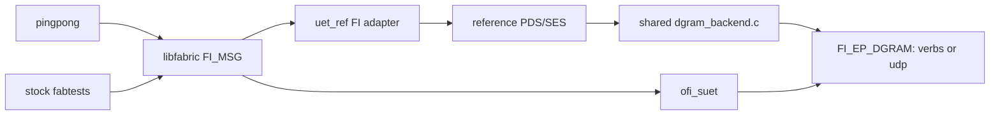

# SUET / reference interoperability through libfabric DGRAM

Ping-pong and performance tests use the **same loadable `uet_ref` provider**,
with the same [dgram_backend.c](dgram_backend.c), packet format, queues and
completion code. `UET_DGRAM_PROVIDER=verbs` or `udp` selects the underlying
libfabric `FI_EP_DGRAM` provider. The former custom UDP socket adapter has
been removed. The application uses libfabric FI_MSG calls for both providers.
TCP exchanges endpoint identities and synchronization records; payload data
always uses DGRAM.



The DGRAM payload is unchanged **PDS/SES bytes**, matching native SUET.
The reference NIC API still expects an internal Ethernet/IP/entropy envelope;
the shared backend removes that envelope and its zero CRC trailer on TX,
then reconstructs it on RX. There is one mapping for both applications and
both transports, with no IP-frame benchmarking mode. The reference uses
`UET_BENCH_DISABLE_CRC=1`, supplied by the recorded reference patch, because
this DGRAM profile has no UET software-CRC trailer on the wire. Underlying
transport integrity checks remain. The original CRC-on/off IP-frame experiment
is preserved in [its archived report](udverbs/README-crc-experiment.md).

## Build on both roce machines

Use the existing SUET install at `/root/suet-interop-20261103/fix6/work/build`
(SUET `0a7b0241`, libfabric base `94f3b1ac` plus its existing patches) and the
reference export at `/root/suet-interop-20261103/ref` (`9effe362`). Copy this
source tree to `/root/suet-interop-20261104/dgram/source`, then run there:

```bash
ROOT=/root/suet-interop-20261103
UET_REF_SOURCE="$ROOT/ref" \
LIBFABRIC_SOURCE="$ROOT/fix6/work/libfabric" \
LIBFABRIC_PREFIX="$ROOT/fix6/work/build" \
INTEROP_BUILD=/root/suet-interop-20261104/dgram/build \
bash tests/interop/build.sh
```

This builds both `build/pingpong` and `build/provider/libuet_ref-fi.so`.
The same `.so` is used by `fi_rdm_pingpong` and `fi_rdm_bw`; there is no
separate copy of the reference NIC or reference core in `pingpong`.
The builder configures a 4,000-byte reference payload maximum in an isolated
source copy and applies [the CRC switch patch](udverbs/patches/0001-pds-benchmark-crc-switch.patch).
The original reference export and previous benchmark installations are preserved.

## Run the two-node test matrix

The controller uses `ssh -J mkhalilov@blue.inf.ethz.ch root@roce00.cscs.ch`
and the equivalent command for roce01. Data addresses are `10.203.44.1` and
`10.203.44.2` on `ens785f0np0`. Both interfaces need their isolated test IPv4
addresses assigned and the RDMA links active for verbs testing.

```bash
python3 tests/interop/run.py --control-port 35300 \
  --output /tmp/dgram-interop
python3 tests/interop/run.py --sr 1 --pairs suet-ref,ref-suet \
  --sizes 16,4001,1048576 --control-port 35500 \
  --output /tmp/dgram-interop-sr
```

The default matrix covers verbs/UDP, ROD/RUD, all four server/client pairings
(`suet-suet`, `ref-ref`, `suet-ref`, `ref-suet`), ten rounds, and sizes
16, 1,024, 1,025, 4,000, 4,001, 65,537 and 1,048,576 bytes. `--sr 0` uses
SUET GBN; `--sr 1` selects SR. `--backends`, `--modes`, `--pairs`, `--sizes`
and `--rounds` narrow the matrix. `--server-host`, `--client-host` and the
corresponding `--server-ip` / `--client-ip` options reverse the physical direction.

The verbs profile uses the native 4 KiB UD limit, giving 4,000 application
bytes per request. SUET selects this with `FI_OFI_SUET_PAYLOAD_MTU=0`, and
the reference selects 4,000. UDP's provider limit is 1,472 bytes, so both
providers select a 1,024-byte application payload for UDP interoperability.
Thus each transport includes single-packet and multi-packet messages with
matching segmentation between providers.

Each client sends ping, the server validates it and sends pong, and the client
validates pong. Both print each operation. The entire byte pattern, message
length and round number are checked. Receives are posted before the peer can
send its next message. Endpoint addresses use opaque DGRAM address bytes;
only the out-of-band logical PID/RI/initiator fields are translated.

`summary.json` records commands, exits and pass counts. Packet capture is
disabled by default in both interoperability and performance tests. For a
small diagnostic run, add `--capture --sizes 16,4001 --rounds 3`; reference-side
captures under the printed remote directory contain exact DGRAM PDS/SES bytes.
Full text capture of large messages can stall progress and trigger retransmits.

```bash
python3 tests/interop/decode.py /path/to/server.packets --limit 20
```

## Performance and profiling

See [the shared-backend benchmark and profiling guide](udverbs/README.md).
Historical socket-UDP interoperability results remain in
[the legacy report](README-udp-legacy.md) and their existing result directories.
