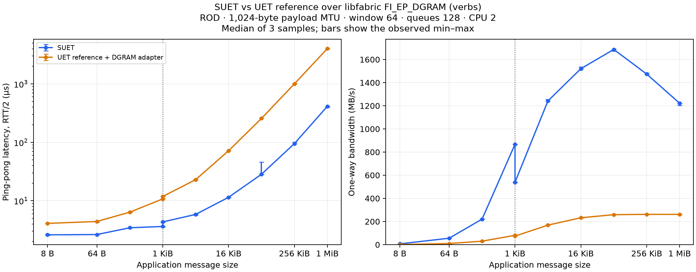

> Archived 1 KiB comparison from commit `c54a871`. For exact reproduction, check out that commit. The current comparison uses the native 4 KiB UD transport profile.

# One-to-one SUET / UET reference comparison over libfabric DGRAM

The reference test NIC uses **libfabric `FI_EP_DGRAM`**, selected with
`prov_name="verbs"` and `domain="mlx5_0-dgram"`. It uses `fi_send`, `fi_recv`,
MR registration, AV exchange and CQ polling. There are no native `ibv_*`
calls in the adapter. SUET uses the same libfabric datagram provider.

The upstream reference repository supplies UET APIs rather than a loadable
provider for these fabtests. `ref_provider.c` supplies the minimal `FI_MSG`
mapping needed to run the **same unmodified `fi_rdm_pingpong` and `fi_rdm_bw`
binaries** on both stacks. It supports one endpoint and one peer per process;
it is scoped to these one-to-one FI_MSG benchmarks.
`ENABLE_VERBS=1` selects the reference API variant with explicit endpoint
identity; the transport still goes through libfabric DGRAM.

The test NIC carries the reference's complete Ethernet/IP/entropy/CRC frame
inside each UD datagram. It does not change PDS/SES bytes or reference
protocol source. Its registered TX/RX pools and batched CQ polling adapt the
reference's synchronous NIC-buffer interface to asynchronous datagrams.
Results include its frame copy and the reference core's existing framing/CRC
work. SUET sends its PDS/SES frames directly. The measurements represent the complete software stacks and their framing
costs with a common datagram backend and application payload MTU.

## Reproduce the build

Both hosts have the validated SUET build at
`/root/suet-interop-20261103/fix6/work/build` and the pinned reference export
at `/root/suet-interop-20261103/ref`. SUET is `0a7b0241f29225b8ff5d2d42d566789d344741a4`;
the reference is `9effe362ec13a7c2c1fa5a79146f5846f0c898c6`.
The same GCC toolchain and `-O2` optimization are used for the reference.

Copy this test directory to each host, then run:

```bash
ROOT=/root/suet-interop-20261103
cd "$ROOT/udcompare/source"
UET_REF_SOURCE="$ROOT/ref" \
LIBFABRIC_SOURCE="$ROOT/fix6/work/libfabric" \
LIBFABRIC_PREFIX="$ROOT/fix6/work/build" \
UD_BUILD="$ROOT/udcompare/build" \
bash tests/interop/udverbs/build.sh > "$ROOT/udcompare/build.log" 2>&1
```

The plugin is `udcompare/build/provider/libuet_ref-fi.so`. No system provider
or library is replaced. `UD_REUSE_CORE=1` is only for relinking adapter changes
against already-built, unchanged reference objects; leave it unset for a fresh
build. The normal build uses the reference sources directly, without patches.

## Run correctness and performance

Run the controller from a computer with the configured SSH jump access:

```bash
python3 tests/interop/udverbs/compare.py --stage correctness --samples 1 \
  --sizes 8,1025,65536,1048576 --output /tmp/ud-correctness
python3 tests/interop/udverbs/compare.py --stage performance --samples 3 \
  --control-port 31000 --output /tmp/ud-performance
```

The controller uses roce00 (`10.203.44.1`) as server and roce01 (`10.203.44.2`)
as client through `mkhalilov@blue.inf.ethz.ch`. `--reverse-hosts` reverses the
physical direction. Every case gets its own TCP control port. Application
data uses DGRAM; TCP carries setup/synchronization outside the timed loops.
Choose a fresh output directory for each run, and run a single performance
controller at a time on these hosts.

Both stacks use ROD, a 1,024-byte payload MTU, backend TX/RX queues of 128,
window 64, manual progress and CPU 2 pinned on each host. SUET uses GBN.
`FI_VERBS_TX_SIZE=128` and `FI_VERBS_RX_SIZE=128` make the underlying capacity
equal; the reference test NIC posts 128 registered receive buffers. Inject
is disabled with `-j 0` so both use the send/completion path. Packet logging
is disabled. Reference security/impairment options remain unset.

Correctness uses `-v`, 128 iterations and 16 warmups. Performance omits byte
validation and uses the same iterations and warmups for both implementations
at each size. Provider order alternates between samples. Ping-pong iterations
range from 10,000 at small sizes to 128 at large sizes. Bandwidth targets
256 MiB per sample, bounded to 256–262,144 iterations. Bandwidth warmups
cover at least two complete application windows. Exact commands,
iteration counts, warmups, exits and individual measurements are in `runs.json`.

Latency is fabtests' `usec/xfer`, **RTT/2**, and bandwidth is application
payload MB/s. The data-validation runs are separate from performance samples.
The short large-message SUET bandwidth samples remain sensitive to startup
and frequency variation; use the raw ranges when interpreting small differences.

To export the complete matrix using an environment containing matplotlib:

```bash
python3 tests/interop/udverbs/plot.py /tmp/ud-performance
```

This writes CSV, a Markdown table, PNG and SVG figures. Medians are over three
samples; plot error bars are the observed minimum and maximum.

## Results

The final comparison is under `results/final-comparison/`. The complete first
sweep is retained in `results/performance-equal-queues/`. Its two bandwidth
tail points had warmups shorter than two application windows; all affected
points (256 KiB and 1 MiB) were repeated with the corrected rule in
`results/tail-warmup-correction/`, and those replacements are used in the
final comparison. All three samples of every affected group were replaced together.
The matched correctness matrix is `results/correctness-equal-queues/`.
The complete existing SUET suite also passed 35/35 cases before this comparison.
Earlier loader/prefix diagnostics and the interrupted, unequal-queue pilot
are retained separately and excluded from the final comparison.


| Bytes | SUET latency, µs | Reference latency, µs | SUET bandwidth, MB/s | Reference bandwidth, MB/s |
| ---: | ---: | ---: | ---: | ---: |
| 8 | 2.61 | 4.10 | 6.95 | 1.27 |
| 64 | 2.64 | 4.42 | 55.75 | 9.68 |
| 256 | 3.45 | 6.38 | 220.78 | 30.25 |
| 1,024 | 3.63 | 10.75 | 867.80 | 80.73 |
| 1,025 | 4.34 | 11.84 | 539.89 | 74.00 |
| 4,096 | 5.84 | 22.98 | 1,241.86 | 168.92 |
| 16,384 | 11.45 | 71.68 | 1,520.32 | 232.38 |
| 65,536 | 28.42 | 256.53 | 1,687.03 | 259.02 |
| 262,144 | 95.13 | 1,003.35 | 1,474.18 | 261.95 |
| 1,048,576 | 412.64 | 4,015.78 | 1,222.45 | 261.59 |

Latency is RTT/2 in microseconds. These are medians of three samples.
SUET has lower latency and higher bandwidth at every measured size in this
configuration. The 1,024/1,025-byte transition crosses the common packet
payload boundary. The reference path includes its existing IP/CRC framing
and the test NIC's registered-buffer copy.



[CSV with medians and observed ranges](results/final-comparison/comparison.csv),
[SVG](results/final-comparison/comparison.svg),
[all selected runs and exact commands](results/final-comparison/runs.json).
`inputs.json` records the raw dataset directories used for the report.

### Large-message window control

Separate 1-MiB bandwidth controls use 1,024 iterations (1 GiB), 102 warmups,
and otherwise identical settings, varying only the application window:

| Application window | SUET, MB/s | Reference + adapter, MB/s |
| ---: | ---: | ---: |
| 1 | 2,322.51 | 264.19 |
| 64 | 1,179.71 | 253.30 |

This shows substantial SUET sensitivity to the number of queued messages.
The controls use longer runs than the full sweep; compare the two control
rows to assess the window effect. The measurements establish the effect,
while identifying its internal cause requires profiling.

For an exact repetition of either control with the current controller:

```bash
python3 tests/interop/udverbs/compare.py --stage performance --tests bw \
  --sizes 1048576 --samples 3 --iterations 1024 --warmup 102 --window 1 \
  --control-port 31300 --output /tmp/ud-window-one
# Repeat with --window 64, a fresh output directory and control port.
```

The final 120 selected timed runs, 16 matched byte-validation runs, all
12 tail-point reruns and 12 long-run control samples completed with zero
process errors and zero reference close-error counters. A 256-KiB
ping-pong repetition logged 63 reference retransmission warnings across its
two processes; its samples and ranges remain in the report. No bandwidth
samples in the full matched sweep logged reference retransmission warnings.
The existing SUET suite passed 35/35. Protocol counters are summarized in
`results/validation-summary.json`; build/source/backend identities are in
`results/roce00.cscs.ch-provenance.json` and the corresponding roce01 file.

To regenerate this stored report from its two raw input datasets:

```bash
python3 tests/interop/udverbs/plot.py \
  tests/interop/udverbs/results/performance-equal-queues \
  --replace tests/interop/udverbs/results/tail-warmup-correction \
  --output /tmp/ud-report
```

The replacement operation substitutes whole size/provider/test groups and
requires all three samples for each group. The CSV includes medians, observed
minimum/maximum values and SUET/reference ratios.
