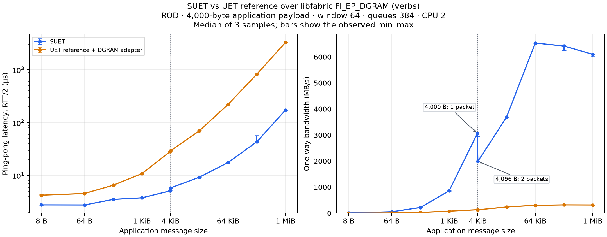

> Archived CRC-on report from commit `d2c4951`; all original results remain unchanged. Use that commit to reproduce the unpatched CRC-on build exactly. The current branch adds a separate CRC-on/off comparison.

# SUET / UET reference: native 4 KiB UD comparison

The current comparison uses the native **4,096-byte UD transport profile**
and **384-entry TX/RX datagram queues** on both implementations. This is
the SUET configuration that reaches approximately **6 GB/s with one endpoint**.
The full matched sweep measured **6,533.67 MB/s at 64 KiB** and
**6,100.99 MB/s at 1 MiB** for SUET (medians of three samples).
A separate one-endpoint, one-core 1-MiB check measured **6,113.75 MB/s** median
(samples: 6,151.89, 6,113.75 and 6,107.17 MB/s).
See [the peak-check commands and samples](results/native4k-suet-peak-check/runs.json).

SUET reserves 40 bytes for the receive prefix, 12 for PDS and 44 for SES,
giving **4,000 bytes of application payload per request** from the advertised
4,096-byte datagram limit. `FI_OFI_SUET_PAYLOAD_MTU=0` preserves that native
transport-derived size. The reference is configured for the same 4,000-byte
segments. This is a transport-sized benchmark profile.

The earlier [1 KiB comparison](README-1k.md) used smaller segments and
128-entry datagram queues. Its commands, plots and raw results remain archived.
Use commit `c54a871` to reproduce that earlier adapter exactly.

## Backend and reference configuration

Both paths use **libfabric `FI_EP_DGRAM`**, provider `verbs`, domain
`mlx5_0-dgram`. The reference adapter uses `fi_send`, `fi_recv`, memory
registration, address vectors and CQ polling. It makes no direct `ibv_*` calls.

The reference NIC carries its IP packet, including entropy, PDS/SES and CRC,
inside the UD datagram. Ethernet is supplied by the transport mapping: the
adapter removes the 14-byte Ethernet header on TX and reconstructs it on RX.
This lets a 4,000-byte reference application segment fit the same 4 KiB
datagram limit without altering PDS/SES or recomputing its CRC. The reference
path retains its IP/CRC processing and a registered-buffer copy.

The pinned reference's compile-time maximum is normally 1,024 bytes. The
builder makes an isolated copy and changes only
`UET_DEFAULT_MAX_PAYLOAD_LEN` to 4,000; this also sizes its gather buffers
consistently. The exact [configuration delta](reference-payload-4000.patch)
is recorded. PDS/SES implementation files remain unchanged. The original
reference export and UDP interoperability installations are preserved.

The `uet_ref` FI_MSG adapter supports the same unmodified `fi_rdm_pingpong`
and `fi_rdm_bw` binaries used for SUET, with one endpoint and one peer per
process. `ENABLE_VERBS=1` selects the reference API variant with explicit
endpoint identity; transport operations go through libfabric DGRAM.

## Build on roce00 and roce01

SUET is `0a7b0241f29225b8ff5d2d42d566789d344741a4`, with libfabric base
`94f3b1ac` and its existing patches. The reference base is
`9effe362ec13a7c2c1fa5a79146f5846f0c898c6` plus the payload-size configuration
above. Both use the same GCC toolchain and `-O2`.

The deployed benchmark sources are under
`/root/suet-interop-20261103/udcompare4k/source`. From that directory on each
host:

```bash
ROOT=/root/suet-interop-20261103
UET_REF_SOURCE="$ROOT/ref" \
LIBFABRIC_SOURCE="$ROOT/fix6/work/libfabric" \
LIBFABRIC_PREFIX="$ROOT/fix6/work/build" \
UD_REFERENCE_PAYLOAD=4000 UD_BUILD="$ROOT/udcompare4k/build" \
bash tests/interop/udverbs/build.sh > "$ROOT/udcompare4k/build.log" 2>&1
```

The loadable adapter is `udcompare4k/build/provider/libuet_ref-fi.so`.
The configured reference source copy is `udcompare4k/build/reference-source`.
`UD_REUSE_CORE=1` is available for relinking adapter-only changes against
unchanged reference objects; a payload-profile change requires a full rebuild.
No system library is replaced.

## Run from the controlling computer

The controller connects through `mkhalilov@blue.inf.ethz.ch` to root on
roce00 (`10.203.44.1`) and roce01 (`10.203.44.2`). The data interface is
`ens785f0np0` and CPU 2 is pinned on each machine.

```bash
python3 tests/interop/udverbs/compare.py --profile native4k \
  --stage correctness --samples 1 --sizes 16,4000,4001,65536,1048576 \
  --control-port 31950 --output /tmp/ud-4k-correctness
python3 tests/interop/udverbs/compare.py --profile native4k \
  --stage performance --samples 3 \
  --control-port 32000 --output /tmp/ud-4k-performance
```

`native4k` is the default profile. Each case gets its own TCP control port;
TCP carries setup/synchronization outside the timed loops. Data uses DGRAM.
Use a fresh output directory and one performance controller at a time.

Both implementations use ROD, application window 64, default 384-entry
datagram queues and the same per-size iterations/warmups. SUET uses GBN.
Inject is disabled with `-j 0` and packet logging is disabled. Provider order
alternates across samples. Correctness uses `-v`; the timed runs omit byte
validation. Bandwidth uses at least 10,000 iterations and 10,000 warmups to
cover the full application window and memory-registration/cache startup.
Large reference runs therefore take longer than SUET runs. All exact
commands and exits are saved in `runs.json`.

Latency is fabtests' `usec/xfer`, **RTT/2**, and bandwidth is application
payload MB/s. These results include each software stack's framing and
buffer-management work. They use one endpoint and one application thread
per process.

## Results and plots

The current full sweep is recorded under `results/native4k-performance/`.
Byte-validation results are in `results/native4k-correctness-verified/`.
The separate SUET peak check is in `results/native4k-suet-peak-check/`.

To regenerate the CSV, table, PNG and SVG with matplotlib:

```bash
python3 tests/interop/udverbs/plot.py \
  tests/interop/udverbs/results/native4k-performance
```

Plots show medians of three samples with observed minimum/maximum error bars.


The 4,000- and 4,096-byte points straddle the effective payload boundary:
4,000 bytes needs one data packet, while 4,096 needs two (4,000 + 96).
The plot labels these separately. The dotted line marks 4,000 application
bytes; the axis tick “4 KiB” denotes 4,096 application bytes.

| Bytes | SUET latency, µs | Reference latency, µs | SUET bandwidth, MB/s | Reference bandwidth, MB/s |
| ---: | ---: | ---: | ---: | ---: |
| 8 | 2.79 | 4.26 | 6.87 | 1.20 |
| 64 | 2.78 | 4.58 | 55.35 | 9.20 |
| 256 | 3.54 | 6.57 | 218.78 | 28.96 |
| 1,024 | 3.80 | 10.89 | 858.90 | 78.64 |
| 4,000 | 5.13 | 28.45 | 3,062.68 | 133.36 |
| 4,096 | 5.84 | 29.52 | 1,991.32 | 129.76 |
| 16,384 | 9.31 | 70.20 | 3,691.46 | 238.37 |
| 65,536 | 17.65 | 221.70 | 6,533.67 | 301.95 |
| 262,144 | 43.45 | 824.10 | 6,419.06 | 318.96 |
| 1,048,576 | 172.93 | 3,299.46 | 6,100.99 | 315.30 |



[CSV with all samples' ranges and ratios](results/native4k-performance/comparison.csv),
[SVG figure](results/native4k-performance/comparison.svg),
[exact performance commands and exits](results/native4k-performance/runs.json).

All **120 performance cases**, **20 byte-validation cases** and the **35-test
SUET basic fabtests suite** passed. The basic suite uses UDP loopback; the
20 payload-validation cases use two-host UD DGRAM and cover 16, 4,000,
4,001, 65,536 and 1,048,576 bytes for both implementations and both benchmarks.

Reference logs report zero errored packets and zero PDC error closures.
One 1-MiB ping-pong repetition logged 44 retransmits and 44 duplicate-PSN
ACK retransmits. The validation runs logged 532 retransmits and 246 duplicate
PSNs under byte checking; those runs are excluded from the timed medians.
Counts and affected logs are recorded in the
[validation summary](results/native4k-validation-summary.json).

Build provenance records the compiler, NIC capabilities, linked libraries,
binary/source hashes and all 160 pinned reference C/header files on each host:
[roce00](results/native4k-roce00.cscs.ch-provenance.json),
[roce01](results/native4k-roce01.cscs.ch-provenance.json).
The isolated reference copy differs only in the documented payload constant.
Complete compressed build logs:
roce00,
roce01.
The basic-suite log is also preserved.

## Why the reference path is slower

A separate 1-MiB bandwidth diagnostic used `perf record -e cycles:u -F 199`
on both peers. It measured 313.56 MB/s, close to the unprofiled 315.30 MB/s
median, and is excluded from the comparison samples. The profile attributes
**83.87% of sender user-space cycles** and **76.37% of receiver user-space
cycles** to `crc32c_update`. Memory copying accounts for 2.60% and 2.04%,
respectively. Both profiles report zero lost samples.

The pinned reference's `util/crc32c.c:116` implements a dependent table lookup
for every byte. `uet_pds.c:465` computes that CRC before sending each packet;
`uet_pds.c:4255` / `:4259` computes it again for receive verification.
The DGRAM adapter preserves this work. The measured bottleneck is therefore
the reference's byte-at-a-time software CRC, rather than the adapter copies.
It explains much of the large-message bandwidth gap; this profile does not
establish the cause of the small-message latency difference.

SUET's current DGRAM path sends PDS/SES directly and does not implement the
reference's additional software CRC/TSS processing. Both paths use the same
underlying verbs DGRAM transport, which supplies its own link integrity.
These are measurements of the current complete implementations; they do not
isolate PDS/SES algorithm efficiency with identical checksum work.

The first optimization to evaluate is an accelerated CRC32C implementation
with identical output, using the available x86 CRC instructions or a suitable
optimized library. It should retain the checksum and pass the existing
validation cases. No CRC optimization or protocol change was made here.

Diagnostic evidence: sender profile,
receiver profile,
[commands](results/native4k-reference-profile/configuration.json),
sender run,
receiver run.
