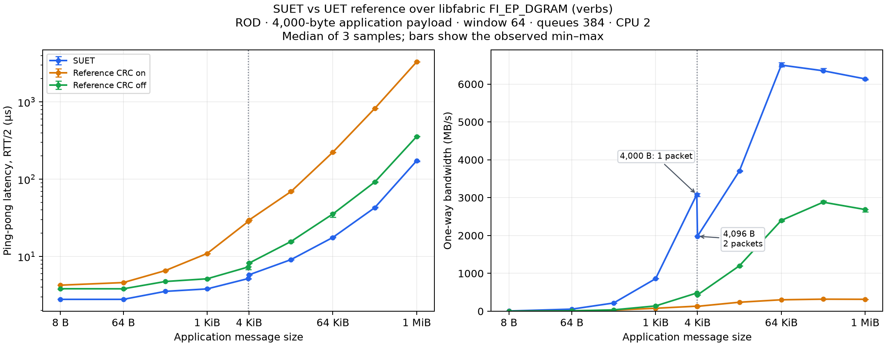

# SUET / UET reference: 4 KiB UD with CRC on and off

This standalone experiment is on `benchmark/ud-crc-on-off-20261103` in
`miharulidze/suet-fork`, based on interoperability commit `d2c4951`.
The original [CRC-on report](README-crc-on.md), commands, plots and raw results
are preserved. Its matched sweep measured SUET at **6,533.67 MB/s at 64 KiB**
and **6,100.99 MB/s at 1 MiB**, using one endpoint and one application core
per peer. The earlier [1 KiB report](README-1k.md) is also retained.

The new comparison runs SUET, reference CRC-on and reference CRC-off at every
size. Both reference modes use the **same patched binary**, with only the
runtime environment setting changed. The SUET provider is unchanged.

## Reference CRC switch patch

Apply [0001-pds-benchmark-crc-switch.patch](patches/0001-pds-benchmark-crc-switch.patch)
to `ultraethernet/uet-ref-prov` commit
`9effe362ec13a7c2c1fa5a79146f5846f0c898c6`:

```bash
cd /path/to/uet-ref-prov
patch -p1 < /path/to/suet/tests/interop/udverbs/patches/0001-pds-benchmark-crc-switch.patch
```

The switch is read once when the full PDS backend initializes:

| Environment | Behavior |
| --- | --- |
| Unset or `UET_BENCH_DISABLE_CRC=0` | Generate and verify the normal software CRC. |
| `UET_BENCH_DISABLE_CRC=1` | Write a zero four-byte trailer on TX and skip CRC calculation/validation on RX. |
| Any other value | Reject initialization with `-EINVAL`. |

Startup prints `UET_BENCH_CRC mode=on` or `mode=off`. Set the same mode on
both peers. Packet sizes, segmentation and CRC trailer space are identical;
the switch changes the software integrity work. UD transport integrity checks
remain, while CRC-off bypasses the UET software integrity check. Encryption
processing is unchanged. This switch covers the full PDS backend, including
its ROD/RUD, RUDI and UUD transmit paths; the separate SNG backend is outside
its scope. The comparison below tests **cleartext ROD**.

The CRC patch is independent of the
[4,000-byte reference payload configuration](reference-payload-4000.patch).
It does not change the reference's normal 1,024-byte compile-time default.

## Build on roce00 and roce01

The controller connects via `mkhalilov@blue.inf.ethz.ch` to root on
roce00 (`10.203.44.1`) and roce01 (`10.203.44.2`). Both hosts use the validated
SUET/libfabric installation at `/root/suet-interop-20261103/fix6/work/build`:
SUET commit `0a7b0241f29225b8ff5d2d42d566789d344741a4`, libfabric base
`94f3b1ac` plus the existing SUET patches. The pinned reference export is
`/root/suet-interop-20261103/ref`.

Copy this directory, including `patches/`, under
`/root/suet-interop-20261103/udcompare4k-crc/source/tests/interop/udverbs` on
both hosts, then run from that source root:

```bash
ROOT=/root/suet-interop-20261103
UET_REF_SOURCE="$ROOT/ref" \
LIBFABRIC_SOURCE="$ROOT/fix6/work/libfabric" \
LIBFABRIC_PREFIX="$ROOT/fix6/work/build" \
UD_REFERENCE_PAYLOAD=4000 UD_BUILD="$ROOT/udcompare4k-crc/build" \
bash tests/interop/udverbs/build.sh > "$ROOT/udcompare4k-crc/build.log" 2>&1
```

The builder copies the reference into `build/reference-source`, applies the
CRC patch and configures its payload maximum to 4,000 bytes. It rebuilds all
reference objects and the FI_MSG/DGRAM adapter with GCC and `-O2`.
The original reference export and the previous CRC-on build are preserved.
The plugin is `udcompare4k-crc/build/provider/libuet_ref-fi.so`.
`UD_REUSE_CORE=1` permits adapter-only relinking; changing the payload or CRC
patch requires a full rebuild and is checked against a configuration hash.

## Backend and measurement settings

Both implementations use **libfabric `FI_EP_DGRAM`**, provider `verbs`, domain
`mlx5_0-dgram`, interface `ens785f0np0`. The reference adapter uses libfabric
send/receive, memory registration, address vectors and CQ polling, with no
direct native `ibv_*` calls. It carries the unchanged reference IP/entropy/
PDS/SES/CRC packet, stripping Ethernet on TX and reconstructing it on RX.

The UD datagram limit is 4,096 bytes. SUET reserves 40 bytes for the receive
prefix, 12 for PDS and 44 for SES, giving **4,000 application bytes per packet**.
`FI_OFI_SUET_PAYLOAD_MTU=0` selects this native size; the reference uses the
same 4,000-byte segments. A 4,000-byte message needs one data packet and a
4,096-byte message needs two. Both points are labeled in the figure.

Each process uses CPU 2, one endpoint, ROD, window 64, 384-entry backend TX/RX
queues, manual progress and no inject (`-j 0`). SUET uses GBN. Both reference
modes retain the reference's framing, buffer management and packet-copy work.
SUET sends PDS/SES directly and does not perform the reference's additional
software CRC/TSS processing. These measurements compare complete stacks.

## Run validation and the comparison

Run from the controlling computer with SSH jump access:

```bash
python3 tests/interop/udverbs/compare.py --stage correctness --samples 1 \
  --sizes 16,4000,4001,65536,1048576 --control-port 32500 \
  --output /tmp/ud-crc-correctness
python3 tests/interop/udverbs/compare.py --stage performance --samples 3 \
  --control-port 33000 --output /tmp/ud-crc-performance
python3 tests/interop/udverbs/check_crc_switch.py \
  --output /tmp/ud-crc-switch-check
python3 tests/interop/udverbs/plot.py /tmp/ud-crc-performance
```

Defaults are `--profile native4k`,
`--root /root/suet-interop-20261103/udcompare4k-crc`, and
`--providers suet,ref-on,ref-off`. Use `--providers ref-on` or `ref-off` for
an individual mode. Each case receives a unique TCP control port; TCP carries
setup/synchronization outside timed loops, and all data uses UD DGRAM.
Use a fresh output directory and one benchmark controller at a time.

The switch check verifies that an unset environment selects CRC-on and that
invalid settings fail initialization on both hosts.

Correctness uses `-v`, 128 iterations and 16 warmups. Performance omits byte
checking and uses equal per-size iterations/warmups across all three paths.
Provider order reverses on alternate repetitions. Bandwidth uses at least
10,000 timed iterations and 10,000 warmups; ping-pong uses 128–10,000 timed
iterations. Latency is fabtests' RTT/2 in microseconds; bandwidth is application
payload MB/s. Figures show medians of three samples with observed min/max bars.

## Original CRC profile

The [CRC-on sender profile](results/native4k-reference-profile/client-perf.txt)
at 1 MiB attributes **83.87% of user-space cycles** to `crc32c_update`;
the [receiver profile](results/native4k-reference-profile/server-perf.txt)
attributes **76.37%**. Its byte-at-a-time lookup loop is in
`util/crc32c.c:116`. The CRC-off experiment isolates that cost while preserving
the packet layout. It does not apply a hardware-accelerated CRC optimization.


## Results

The full sweep passed **180/180 performance cases**: three implementations/
modes, two benchmarks, ten message sizes and three repetitions. All **30/30
payload-validation cases**, **8/8 switch API checks** and **35/35 basic SUET
fabtests** passed. The basic suite uses UDP loopback; the comparison and
payload-validation cases use two-host verbs DGRAM.

At 1 MiB, reference CRC-off reaches **2,686.51 MB/s**, versus **315.29 MB/s**
with CRC on: **8.52 times the bandwidth**. SUET reaches **6,137.42 MB/s**.
CRC-off reduces reference 1-MiB latency from **3,305.78 to 357.21 µs**;
SUET measures **173.57 µs**. All are medians of three samples.

The fresh CRC-on 1-MiB bandwidth is effectively unchanged from the original
315.30 MB/s. SUET's fresh 1-MiB median is 0.60% above its original
6,100.99 MB/s, and its 64-KiB median remains **6,501.91 MB/s**. Source/binary
hashes confirm that the native SUET/libfabric and fabtests builds are unchanged.

| Bytes | SUET latency, µs | Reference CRC on latency, µs | Reference CRC off latency, µs | SUET bandwidth, MB/s | Reference CRC on bandwidth, MB/s | Reference CRC off bandwidth, MB/s |
| ---: | ---: | ---: | ---: | ---: | ---: | ---: |
| 8 | 2.79 | 4.26 | 3.83 | 6.94 | 1.20 | 1.32 |
| 64 | 2.79 | 4.60 | 3.82 | 55.28 | 9.22 | 10.46 |
| 256 | 3.54 | 6.57 | 4.75 | 217.89 | 28.94 | 36.59 |
| 1,024 | 3.81 | 10.95 | 5.15 | 859.98 | 78.42 | 140.28 |
| 4,000 | 5.19 | 28.46 | 7.33 | 3,083.79 | 133.51 | 481.34 |
| 4,096 | 5.80 | 29.63 | 8.21 | 1,981.16 | 129.53 | 431.28 |
| 16,384 | 9.11 | 69.21 | 15.64 | 3,705.73 | 237.78 | 1,199.92 |
| 65,536 | 17.66 | 223.95 | 35.54 | 6,501.91 | 302.31 | 2,399.49 |
| 262,144 | 42.89 | 824.93 | 91.99 | 6,352.16 | 318.64 | 2,880.51 |
| 1,048,576 | 173.57 | 3,305.78 | 357.21 | 6,137.42 | 315.29 | 2,686.51 |



[CSV, ranges and speedups](results/crc-switch-performance/comparison.csv),
[SVG figure](results/crc-switch-performance/comparison.svg),
[performance commands/exits](results/crc-switch-performance/runs.json),
[payload-validation commands/exits](results/crc-switch-correctness/runs.json),
[switch API checks](results/crc-switch-api-check/summary.json),
[basic SUET suite log](results/crc-switch-suet-fabtests.log.gz).
The [validation summary](results/crc-switch-validation-summary.json) records
counts, warning locations, binary identity and baseline comparisons.

Reference logs report zero errored packets, zero PDC error closures and no
CRC mismatch errors in either mode. One timed CRC-on 1-MiB ping-pong sample
logged 59 retransmits and 59 duplicate-PSN ACK retransmits. Timed CRC-off
samples logged neither warning. Under byte validation, each reference mode
logged 532 retransmits and 246 duplicate-PSN warnings; those validation runs
are excluded from the timed medians and still passed data checking.

Both hosts use the identical patched reference binary. Provenance verifies
all 160 reference C/header files against the pinned commit, allowing only
the CRC patch and the payload-limit configuration. Records and compressed
build logs: [roce00 provenance](results/crc-switch-roce00.cscs.ch-provenance.json),
[roce01 provenance](results/crc-switch-roce01.cscs.ch-provenance.json),
[roce00 build](results/crc-switch-roce00.cscs.ch-build.log.gz),
[roce01 build](results/crc-switch-roce01.cscs.ch-build.log.gz).

## CRC-off CPU profile

A separate 1-MiB diagnostic on the same patched binary used
`perf record -e cycles:u -F 199` with CRC disabled. Neither peer's profile
contains sampled CRC routines; both report zero lost samples. Remaining
sampled work is distributed across copies, locking, timekeeping, packet/
queue processing and reliability bitmaps. Sender memory-copy samples account
for 17.03% of user-space cycles, compared with 83.87% previously spent in
`crc32c_update` with CRC on. This diagnostic is excluded from the comparison
medians and does not quantitatively attribute the remaining SUET/reference gap.

[Sender profile](results/crc-switch-reference-off-profile/client-perf.txt),
[receiver profile](results/crc-switch-reference-off-profile/server-perf.txt),
[diagnostic commands](results/crc-switch-reference-off-profile/configuration.json),
[sender run](results/crc-switch-reference-off-profile/client.log),
[receiver run](results/crc-switch-reference-off-profile/server.log).
