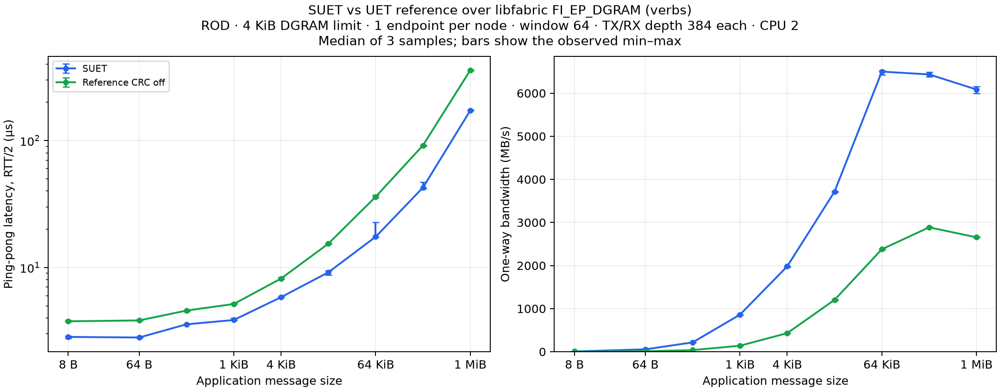

# SUET / original reference protocol over the shared DGRAM adapter

Interoperability ping-pong and stock fabtests load the **same `uet_ref` module**
and [DGRAM backend](../dgram_backend.c), using `FI_EP_DGRAM` over verbs or UDP.
The reference is pinned to `9effe362ec13a7c2c1fa5a79146f5846f0c898c6`.
Only the approved [CRC switch](patches/0001-pds-benchmark-crc-switch.patch) and
the requested 4,000-byte maximum-payload configuration are applied to the
private reference copy. **No reference reliability, NACK, ordering or other
protocol changes are applied.**

The additional reference GoBackN patch and helper tests have been removed.
The prior [report with that patch](README-protocol-patch-superseded.md) is
explicitly superseded; its passing matrices are not results for the original
reference protocol. The original [CRC-on/off experiment](README-crc-experiment.md)
and its raw results remain available.

## Comparison: ROD, one endpoint per node

All **120/120 ROD** timing jobs passed. Each point is the median of three
repetitions. Both providers use **one application endpoint per node**, one
process per node, CPU 2, and the same packet sizes, queues, window, warmups
and iteration counts. Native SUET uses GBN. This figure was regenerated from
the saved ROD samples; no experiments were rerun.

| Message size | SUET ROD MB/s | Reference ROD MB/s |
| --- | ---: | ---: |
| 4 KiB | 1,981.35 | 430.35 |
| 64 KiB | 6,501.07 | 2,378.03 |
| 1 MiB | 6,086.63 | 2,655.08 |



The reference has CRC disabled. The figure includes **4 KiB (4,096 bytes)**
and omits the 4,000-byte message-size point. [Latency/bandwidth table](results/dgram-original-protocol-performance-20261104/table.md),
[CSV with latency/bandwidth ranges](results/dgram-original-protocol-performance-20261104/comparison.csv),
[SVG](results/dgram-original-protocol-performance-20261104/comparison.svg), and
[ROD samples](results/dgram-original-protocol-performance-20261104/runs.json).

The earlier [combined ROD/RUD figure](results/dgram-original-protocol-rod-rud-comparison-20261104/comparison.png)
and [RUD samples](results/dgram-original-protocol-rud-performance-20261104/runs.json)
remain available; all **108/108 RUD** timing jobs passed.

[RUD validation](results/dgram-original-protocol-rud-validation.json) checks the
matched iteration/warmup counts, unordered endpoint contract and zero reference
error-close counters. The [single-endpoint source evidence](results/dgram-original-protocol-endpoint-setup.json)
shows the benchmark creates one endpoint per process, with one process on each node.

## Build once for interop and benchmarking

```bash
ROOT=/root/suet-interop-20261103
UET_REF_SOURCE="$ROOT/ref" \
LIBFABRIC_SOURCE=/root/suet-interop-20261104/native-gap/libfabric \
LIBFABRIC_PREFIX=/root/suet-interop-20261104/native-gap/build \
INTEROP_BUILD=/root/suet-interop-20261104/dgram/build \
bash tests/interop/build.sh
```

The builder explicitly applies only `0001-pds-benchmark-crc-switch.patch`.
The same output `build/provider/libuet_ref-fi.so` serves both the interop app
and stock fabtests. The shared PDS/SES mapping uses `UET_BENCH_DISABLE_CRC=1`.
Verbs uses its 4-KiB DGRAM limit with 4,000 application bytes per packet;
UDP uses 1,024 application bytes to fit its 1,472-byte DGRAM limit.

## Run and plot

To regenerate only the ROD figure from the saved measurements, without running
any benchmarks:

```bash
python3 tests/interop/udverbs/plot.py \
  tests/interop/udverbs/results/dgram-original-protocol-performance-20261104 \
  --exclude-size 4000
```

To collect new measurements:

```bash
python3 tests/interop/udverbs/compare.py --stage correctness --samples 1 \
  --sizes 16,4000,4001,65536,1048576 --control-port 40200 \
  --output /tmp/original-protocol-correctness
python3 tests/interop/udverbs/compare.py --stage performance --samples 3 \
  --control-port 40400 --output /tmp/original-protocol-performance
python3 tests/interop/udverbs/plot.py /tmp/original-protocol-performance --exclude-size 4000
```

The figure shows only **4 KiB (4,096 bytes)** at the message-size transition;
4,000-byte messages are excluded from both plot panels. Raw results, CSV and
tables retain all measured sizes. The 4,000-byte per-packet setting remains
part of the transport configuration.

The comparison uses **one endpoint per node**, one process on roce00 and one
on roce01, each pinned to CPU 2. Both use ROD, a requested application window of 64,
inject disabled and 384-entry DGRAM queues. Timed bandwidth uses at least
10,000 measured iterations after 10,000 warmups, with matching settings for
both providers. Plots show medians of three samples with observed min/max bars.
Latency is RTT/2 in microseconds; bandwidth is application-payload MB/s.

## Reference source audit

All 160 actual reference C/header files on each host were compared with the
pinned source plus only the CRC switch and payload configuration. Build logs,
source and binary hashes, and node metadata are recorded for
[roce00](results/dgram-original-protocol-roce00.cscs.ch-provenance.json) and
[roce01](results/dgram-original-protocol-roce01.cscs.ch-provenance.json).

## Interoperability

The [interop guide](../README.md) describes address exchange and the shared
backend. Reruns with the original reference protocol are recorded in
[the current interop matrix](../results/dgram-original-protocol-interop-20261104/summary.json).
Failed mixed-provider cases are recorded in structured summaries, with raw
logs outside Git; the reference protocol is not modified to make them pass.

## Current correctness results

ROD stock fabtests with full byte validation passed **20/20 cases on verbs** and
**20/20 cases on UDP**, covering native SUET and reference ping-pong/bandwidth
through 1 MiB. Commands and exits:
[verbs](results/dgram-original-protocol-correctness-verbs-20261104/runs.json),
[UDP](results/dgram-original-protocol-correctness-udp-20261104/runs.json).

The mixed-provider application rerun passed **31/32** cases, including both
roles, ROD/RUD and additional native RUD SR coverage. A 1-MiB UDP ROD case
failed: reference exhausted NACK retries and SUET timed out waiting for ping.
That failure remains; no reference protocol fix is applied. The
[interop guide](../README.md#original-protocol-rerun) links the exact failing
logs and the passing-case error-close audit. The earlier 112/24 matrices used
the withdrawn protocol patch and are explicitly superseded.
## Fresh profiles of the original reference protocol

The diagnostic 1-MiB counter runs measured **6,095.96 MB/s SUET** and
**2,671.76 MB/s reference CRC-off**. Each sent 100,000 messages after 10,000
warmups. Separate call-stack runs measured 6,045.03 and 2,650.72 MB/s. These
diagnostic runs are excluded from the three-sample plot medians.

| User counter per application byte | SUET sender | Reference sender | SUET receiver | Reference receiver |
| --- | ---: | ---: | ---: | ---: |
| Cycles | 0.489 | 1.162 | 0.539 | 1.265 |
| Instructions | 0.833 | 1.619 | 0.673 | 2.311 |

Reference uses **2.38x sender cycles/byte** and **2.35x receiver cycles/byte**.
The counters include setup, warmup and teardown. Call-stack percentages below
use the same 6–12 second steady-state interval on both peers, excluding startup
and close-wait work.

| Steady-state self-cycle samples | SUET sender | Reference sender | SUET receiver | Reference receiver |
| --- | ---: | ---: | ---: | ---: |
| Copies and zeroing | 0.58% | 25.57% | 41.17% | 18.53% |
| Heap management | 7.12% | 9.79% | 2.85% | 8.96% |
| Timekeeping | 3.00% | 3.00% | 1.91% | 11.82% |
| Reliability bitmaps | 0.00% | 5.61% | 0.00% | 6.46% |

The source and caller stacks identify these costs:

- Reference assembles each outgoing packet in an allocated frame, then the
  DGRAM NIC copies it into a registered TX slot. Its RX path copies from the
  DGRAM slot into a reference frame, then into the application buffer. Native
  SUET uses registered IOVs for large-message TX and one receive payload copy.
- Reference allocates/frees packet descriptors and frames per packet; native
  SUET reuses pools.
- Each reference CQ progress call runs aging/timer work, processes one incoming
  packet, checks TX progress and visits queued messages. Reference bitmap
  advancement also shifts bitmap/pointer windows; native uses a circular window.

These profiles associate the large-message gap with additional CPU work per
delivered byte. Sample percentages describe where each provider spends its own
cycles at different throughputs; they are not additive predicted speedups.
Locks exist in both stacks. No reference protocol or performance optimization
has been applied to obtain these results.

[Commands and exits](results/dgram-original-protocol-profile-20261104/runs.json),
[counter/category analysis](results/dgram-original-protocol-profile-20261104/analysis.json),
reference sender callers,
and reference receiver callers.

Reproduce the matched large-message profiles with:

```bash
python3 tests/interop/udverbs/profile.py \
  --baseline tests/interop/udverbs/results/dgram-original-protocol-performance-20261104/runs.json \
  --provider-root /root/suet-interop-20261104/dgram \
  --fabric /root/suet-interop-20261104/native-gap/build \
  --remote /root/suet-interop-20261104/profiles-original-protocol \
  --samples 1 --control-port 40600 --output /tmp/original-protocol-profile
```

## Raw output and queue sizes

Raw logs, packet traces and perf text output are stored outside Git. The
controllers default to fresh system-temporary directories and accept
`--log-dir`; `runs.json` records `log_directory`. Profile analysis reads that
location, or an explicit `analyze_profile.py RESULTS --logs LOG_DIRECTORY`.
Only structured summaries, commands, source/binary hashes, tables and figures
are retained in the repository.

“Queues 384” means 384 transmit entries and 384 receive entries per underlying
DGRAM endpoint on each node. Reference preposts 384 receive buffers and maintains
384 registered send slots; native verbs uses the matching queue capacities.
The application uses one endpoint per node. Window 64 is the outstanding-message
limit, independently of those packet-queue capacities.

## RUD benchmark selection

`compare.py --mode rud` selects an unordered endpoint contract for the same
stock fabtests executables. Stock fabtests has no message-order CLI switch,
so `endpoint_order.so` changes only the returned application `fi_info` TX/RX
`msg_order` to zero during discovery. It refuses explicit nonzero ordering
requirements and RMA/atomic tests. It does not intercept sends, receives or
CQ reads, and does not modify either provider's protocol. Reference also uses
its existing RUD selection through the FI adapter.

The [setup-helper build records](results/rud-endpoint-setup-roce00.cscs.ch.json)
verify the reference module hash remains unchanged. [Packet-type checks](results/dgram-original-protocol-mode-verification-20261104/summary.json)
observed ROD request type 3 and RUD request type 2 from both providers using
the stock benchmark. Native transmit headers were inspected at the send
boundary; reference TX/RX DGRAM captures were decoded. Raw debugger/capture
output stays outside Git.

[All 16 RUD correctness cases](results/dgram-original-protocol-rud-correctness-verbs-20261104/runs.json)
passed full byte validation through 1 MiB. Use the same one-endpoint-per-node
configuration for a RUD performance run:

```bash
python3 tests/interop/udverbs/compare.py --mode rud --stage performance --samples 3 \
  --sizes 8,64,256,1024,4096,16384,65536,262144,1048576 \
  --control-port 41400 --output /tmp/original-protocol-rud-performance
```

## Reproduce the combined ROD/RUD figure

Run the two timed sweeps sequentially, using the same binaries and providers:

```bash
python3 tests/interop/udverbs/compare.py --mode rod --stage performance --samples 3 \
  --control-port 40400 --output /tmp/original-protocol-rod
python3 tests/interop/udverbs/compare.py --mode rud --stage performance --samples 3 \
  --sizes 8,64,256,1024,4096,16384,65536,262144,1048576 \
  --control-port 41400 --output /tmp/original-protocol-rud
python3 tests/interop/udverbs/plot_modes.py \
  /tmp/original-protocol-rod /tmp/original-protocol-rud \
  --output /tmp/original-protocol-rod-rud-figure
```

The combined plot excludes 4,000-byte messages by default. Individual mode
plots remain available through `plot.py RESULTS --exclude-size 4000`.

The post-run [roce00 provenance](results/rud-final-roce00.cscs.ch-provenance.json)
and [roce01 provenance](results/rud-final-roce01.cscs.ch-provenance.json) confirm
that ROD and RUD used the same native library and reference module. All 160
reference source/header files still match the pin plus only the approved CRC
switch and payload configuration. The discovery helper is a separate test
component; the reference protocol binary was not rebuilt or modified for RUD.
