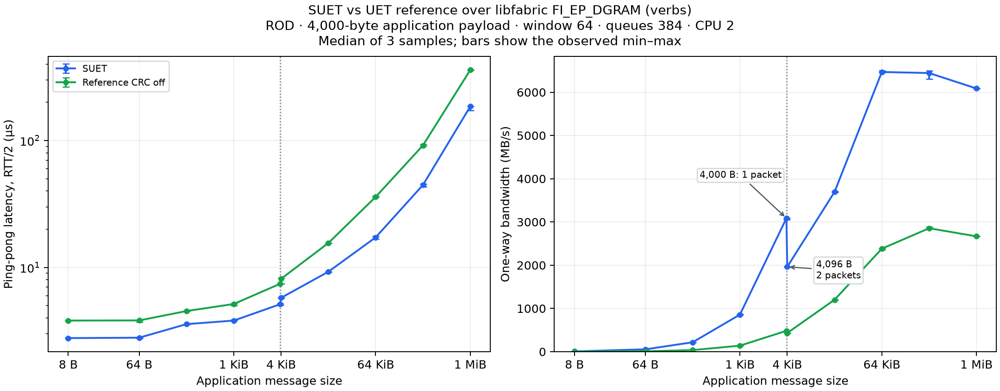

# SUET / reference performance using the shared DGRAM adapter

The reference FI provider and [shared DGRAM backend](../dgram_backend.c) are
built once and loaded by both interoperability ping-pong and stock fabtests.
Both use the same PDS/SES payload mapping and `FI_EP_DGRAM` transport; there
is no special performance-only packet envelope. See [the interoperability
build/run guide](../README.md) for the complete architecture and node setup.

This work is on `interop/dgram-backends-20261104`, based on `b4c3e14`.
The original [CRC-on/off experiment](README-crc-experiment.md),
[CRC-on report](README-crc-on.md) and [1 KiB report](README-1k.md), including
all raw results, are preserved with their original adapter details.

## Final shared-DGRAM comparison

All 120 timing jobs passed. These are medians of three repetitions using the
final shared module and native gap-NACK fix; profile runs are separate.

| Application message | SUET bandwidth | Reference CRC-off bandwidth | SUET / reference |
| --- | ---: | ---: | ---: |
| 4,000 B (one packet) | 3,086.13 MB/s | 483.15 MB/s | 6.39x |
| 4,096 B (two packets) | 1,962.48 MB/s | 432.25 MB/s | 4.54x |
| 64 KiB | 6,467.77 MB/s | 2,382.44 MB/s | 2.71x |
| 1 MiB | 6,086.56 MB/s | 2,667.44 MB/s | 2.28x |



[All latency/bandwidth medians](results/dgram-final-performance-20261104/table.md),
[CSV including observed ranges](results/dgram-final-performance-20261104/comparison.csv),
[SVG figure](results/dgram-final-performance-20261104/comparison.svg), and
[raw samples, commands and exits](results/dgram-final-performance-20261104/runs.json).
The two nearby MTU-boundary points are different application sizes: 4,000
bytes fits one packet, while 4,096 bytes needs two; the figure labels both.

## Build once for both applications

```bash
ROOT=/root/suet-interop-20261103
UET_REF_SOURCE="$ROOT/ref" \
LIBFABRIC_SOURCE=/root/suet-interop-20261104/native-gap/libfabric \
LIBFABRIC_PREFIX=/root/suet-interop-20261104/native-gap/build \
INTEROP_BUILD=/root/suet-interop-20261104/dgram/build \
bash tests/interop/build.sh
```

The output is `/root/suet-interop-20261104/dgram/build/provider/libuet_ref-fi.so`,
used by both test programs. The source is pinned reference `9effe362` plus
the existing [CRC switch patch](patches/0001-pds-benchmark-crc-switch.patch),
the [ROD GoBackN correction](patches/0002-pds-rod-gobackn.patch),
and the 4,000-byte payload configuration. The shared PDS/SES mapping requires
`UET_BENCH_DISABLE_CRC=1`; CRC-on results apply to the earlier IP-frame adapter
and are explicitly archived rather than mixed into this comparison.

## Benchmark

```bash
python3 tests/interop/udverbs/compare.py --stage correctness --samples 1 \
  --sizes 16,4000,4001,65536,1048576 --control-port 35800 \
  --output /tmp/shared-dgram-correctness
python3 tests/interop/udverbs/compare.py --stage performance --samples 3 \
  --control-port 36000 --output /tmp/shared-dgram-performance
python3 tests/interop/udverbs/plot.py /tmp/shared-dgram-performance
```

Defaults are `--root /root/suet-interop-20261104/dgram`, `--backend verbs` and
`--providers suet,ref-off`. `--backend udp` selects the exact same shared
adapter over the UDP provider, with a 1,024-byte application payload to fit
its 1,472-byte DGRAM limit. Verbs uses the native 4 KiB transport profile and
4,000 application bytes per data packet.

Each peer uses one endpoint, CPU 2, ROD, window 64, inject disabled, and
384-entry verbs TX/RX queues. Window 64 is the requested application window;
the reference ROD message-completion restriction is analyzed below. Native
SUET uses GBN. Correctness uses full
byte validation. Timed bandwidth uses at least 10,000 iterations plus 10,000
warmups, with equal settings for both providers and three repetitions.
Latency is RTT/2 in microseconds, and bandwidth is application payload MB/s.
Plots show medians with observed min/max error bars.

## Matched profiling

```bash
python3 tests/interop/udverbs/profile.py --samples 1 \
  --provider-root /root/suet-interop-20261104/dgram \
  --fabric /root/suet-interop-20261104/native-gap/build \
  --control-port 34100 --output /tmp/matched-dgram-profiles
```

The profiler reuses the recorded 1-MiB benchmark commands, selects the shared
provider binary, and uses 100,000 iterations plus 10,000 warmups on both
implementations. It records both sender and receiver. `perf stat` records
user cycles, instructions, task-clock, cache misses and context switches for
the whole invocation; those counts include setup, warmup and teardown.
Separate `perf record -e cycles:u -F 199 --call-graph dwarf,8192` runs collect
call stacks. Flat and caller reports use the same 6–12 second interval after
the first sample, excluding startup, warmup and the reference close-wait loop.
Profiling runs are kept out of the three-sample benchmark medians.


## Matched profile: where the remaining gap comes from

With this single shared PDS/SES adapter, the counter runs measured **6,110.84
MB/s for SUET** and **2,651.95 MB/s for reference CRC-off**, a **2.30x gap**.
The diagnostic call-stack runs measured 6,084.90 and 2,659.07 MB/s respectively.
No CRC routine appears in the sampled profiles; all profile jobs exited zero.
Both peers used one endpoint/core, 4,000-byte payloads, window 64 and the same
verbs DGRAM provider, queues and fabric installation.

| Counter, per application byte | SUET sender | Reference sender | SUET receiver | Reference receiver |
| --- | ---: | ---: | ---: | ---: |
| User CPU cycles | 0.488 | 1.174 | 0.538 | 1.269 |
| Retired user instructions | 0.836 | 1.620 | 0.673 | 2.338 |

The reference consumes **2.41x sender cycles/byte** and **2.36x receiver
cycles/byte**. It retires **3.48x receiver instructions/byte**. This matches
the throughput gap: substantially more CPU work is performed per delivered
byte, even after CRC removal. Counter values cover the full invocation;
the profiles below isolate the identical steady-state interval.

| Steady-state self-cycle samples | SUET sender | Reference sender | SUET receiver | Reference receiver |
| --- | ---: | ---: | ---: | ---: |
| Copies and zeroing | 0.76% | 24.64% | 40.13% | 17.25% |
| Heap management | 7.71% | 9.48% | 3.36% | 8.31% |
| Locking | 25.81% | 19.04% | 10.14% | 17.16% |
| Timekeeping | 3.33% | 3.08% | 1.33% | 11.87% |
| Reliability bitmaps | 0.00% | 5.61% | 0.00% | 6.38% |

Percentages are within each core at different throughputs; a lower percentage
can still mean greater cost per application byte. The caller stacks and source
identify these concrete costs:

- **Extra full-payload copies.** The reference PDS copies payload into its
  allocated frame in `uet_pds_tx_pkt`; the shared asynchronous DGRAM NIC then
  copies into its registered TX slot. On RX, the NIC copies into the reference
  frame, and SES copies into the posted application buffer. That is two TX
  and two RX payload copies. Native SUET's large-message TX uses registered
  IOVs, and its receive path copies into the application buffer. The reference
  sender's copy stacks specifically account for 13.91% in PDS packet assembly
  and 7.63% in the NIC TX copy, versus less than 1% total copying/zeroing on the
  native sender.
- **Per-packet allocation and freeing.** The reference allocates a PDS packet
  descriptor/frame in `uet_pds_tx_pkt`, allocates an RX frame in
  `uet_pds_sec_rx_pkt`, and frees retained packets while advancing its window.
  Native SUET reuses packet/descriptor pools. This difference is visible in
  the calloc/free stacks and the heap-management samples above.
- **Progress, timer and window bookkeeping.** Every `uet_cq_read` takes the
  endpoint mutex and runs `uet_ep_progress_locked`: message aging, sync-group
  aging, one receive packet, transmit progress and deferred sends. The reference
  also physically shifts bitmap/pointer windows (`bm_shift_right`) as ACKs
  advance. Native SUET drains batches and uses its circular reliability window.
  Reference receiver timekeeping is 11.87% of samples, versus 1.33% for SUET;
  reference bitmap work is another 6.38%.
- **Locking is present in both stacks.** The caller reports distinguish
  reference API/CQ locks from verbs send/CQ locks. Native sender locking is
  itself substantial; the result does not justify attributing the whole gap
  to a reference-only lock or to the NIC adapter alone.

The FI adapter uses the reference vector entrypoint, but the reference collapses
a single IOV to its contiguous-buffer representation. These scalar benchmarks
do **not** execute the multi-IOV gather allocation/copy path. No scalar/vector
optimization is claimed as an explanation for these measurements.

The next performance changes to evaluate are packet-buffer pools, eliminating
frame/registered-slot copies through an explicit asynchronous buffer-lifetime
contract, and batching reference progress/timer/window updates. Those are
proposed optimizations, not measured speedups. The current profile attributes
the remaining cost across these paths; it does not establish an additive
speedup from independently removing them.

Raw evidence: [all profiling commands/exits](results/dgram-final-profile-20261104/runs.json),
[counter/category analysis](results/dgram-final-profile-20261104/analysis.json),
[SUET sender callers](results/dgram-final-profile-20261104/suet-record-r0-1-callers.txt),
[reference sender callers](results/dgram-final-profile-20261104/ref-off-record-r0-1-callers.txt),
[SUET receiver callers](results/dgram-final-profile-20261104/suet-record-r0-0-callers.txt),
[reference receiver callers](results/dgram-final-profile-20261104/ref-off-record-r0-0-callers.txt).
Run `analyze_profile.py RESULTS_DIRECTORY` to regenerate the analysis JSON.

## Why the one-packet message gap is larger

At 4,000 bytes, the matched diagnostic counter run measured 3,063.41 MB/s for
SUET and 484.51 MB/s for reference CRC-off (6.32x). Each sent 3,000,000
messages after 10,000 warmups. Separate call-stack runs used the same 1–3
second steady-state interval on both peers; all four jobs passed and no
samples were lost. The shorter interval gives coarser sample percentages than
the 1-MiB profile, so use these as hotspot estimates.

| Whole-invocation counter per application byte | SUET | Reference CRC off |
| --- | ---: | ---: |
| Sender user cycles | 0.976 | 6.620 |
| Receiver user cycles | 1.192 | 7.248 |
| Sender instructions | 1.800 | 11.458 |
| Receiver instructions | 2.155 | 14.172 |

The pinned reference has a **per-peer ROD message-completion gate**:
`uet_tx_msg_try` sends only the AV's current sequence number;
`uet_tx_cq_post_entry` advances that sequence only when the previous message
completes, after its unacknowledged-packet count reaches zero. Thus requesting
`-W 64` queues 64 application messages, but does not put 64 ROD messages in
flight to that peer. This is visible in the unchanged pinned
[sequence gate](https://github.com/ultraethernet/uet-ref-prov/blob/9effe362ec13a7c2c1fa5a79146f5846f0c898c6/uet_api.c#L5701),
[completion advancement](https://github.com/ultraethernet/uet-ref-prov/blob/9effe362ec13a7c2c1fa5a79146f5846f0c898c6/uet_api.c#L1604),
and [ACK-dependent state transition](https://github.com/ultraethernet/uet-ref-prov/blob/9effe362ec13a7c2c1fa5a79146f5846f0c898c6/uet_api.c#L1704).

Each reference CQ read processes one incoming packet and then visits the
queued TX ring, rotating descriptors that cannot proceed. At this size the
sender spends about **31% self samples in `uet_ep_progress_locked`**, including
its inlined progress work, and another **19% in `uet_tx_desc_ring_rotate`**.
Copies/zeroing are only about **2.5%**. The receiver spends about **30% on
timekeeping** and **31% on locks** while driving this polling path. The ring
rotation itself is constant-time; the cost is repeatedly visiting queued
messages on successive progress calls.

A separate three-sample **window-1 control**, with the same binaries, CPU,
payload and queues, measured **519.42 MB/s SUET** versus **403.92 MB/s
reference**, only **1.29x apart**, versus 6.39x with window 64. This diagnostic
used 100,000 measured messages and 10,000 warmups. It corroborates the source
and profiles: native SUET benefits much more from pipelining multiple messages,
while the reference's completion gate and queued-message progress dominate
this one-packet workload. A 1-MiB message already provides hundreds of packets
to pipeline, so this per-message restriction is amortized and the remaining
large-message gap is mainly the per-packet work detailed above.

Evidence: [4,000-byte commands and exits](results/dgram-final-profile-4000-20261104/runs.json),
[counter/hotspot analysis](results/dgram-final-profile-4000-20261104/analysis.json),
[sender callers](results/dgram-final-profile-4000-20261104/ref-off-record-r0-1-callers.txt),
[receiver callers](results/dgram-final-profile-4000-20261104/ref-off-record-r0-0-callers.txt),
and [window-1 raw samples](results/dgram-final-window1-20261104/runs.json).
Reproduce the short profile with:

```bash
python3 tests/interop/udverbs/profile.py \
  --baseline tests/interop/udverbs/results/dgram-final-performance-20261104/runs.json \
  --bytes 4000 --iterations 3000000 --warmup 10000 --samples 1 \
  --sample-start 1 --sample-seconds 2 \
  --provider-root /root/suet-interop-20261104/dgram \
  --fabric /root/suet-interop-20261104/native-gap/build \
  --remote /root/suet-interop-20261104/profiles-4000 \
  --control-port 38500 --output /tmp/dgram-4000-profile
```

The additional performance changes to evaluate are decoupling ROD submission
ordering from message-completion ordering, and driving a queue of work that
can proceed rather than rescanning blocked messages on every CQ poll. ROD
messages must still be sent without packet interleaving. These are proposed
optimizations; this branch makes the interoperability fixes and does not
implement those performance changes.

## Shared-adapter validation baseline

Both hosts built the same reference adapter and libfabric-only application.
The initial eight single-packet controls/mixed cases passed on verbs and UDP.
With packet capture disabled, ten 1-MiB rounds passed in both mixed roles and
both ROD/RUD modes over verbs. The native basic fabtests suite passed 35/35.
Build/source/library provenance is recorded for
[roce00](results/dgram-baseline-roce00.cscs.ch-provenance.json) and
[roce01](results/dgram-baseline-roce01.cscs.ch-provenance.json).

The baseline UDP 1-MiB mixed cases exposed loss-recovery bugs. SUET's ROD gap
NACK omits Expected_PSN in its payload; the pinned reference handles ROD
out-of-order NACKs with individual retries instead of GoBackN. Native GBN on
RUD also reports an in-window gap as an out-of-window error. The subsequent native and reference
fixes are documented below, with baseline failures preserved. The
[UEC ROD requirements, section 3.5.21.1](https://ultraethernet.org/uec-1-0-spec)
require the missing expected PSN in a ROD NACK payload and ordered GoBackN
retransmission beginning there.

The native gap-NACK issue is corrected in `03f9f4d`; its basic fabtests passed
35/35 and native 1-MiB UD bandwidth remains about 6.08 GB/s. The subsequent
reference ROD patch replays from Expected_PSN rather than retrying only the
later offending packet. The formerly failing UDP 1-MiB mixed cases now pass in
both modes and both roles; see the
[protocol fixes and regression evidence](../README.md#native-gap-nack-correction).

The earlier [pre-fix profile](results/matched-dgram-profile-20261104/analysis.json)
is preserved separately. The final profiles above use the same final binaries
as the three-sample comparison, after both protocol fixes.

## Final correctness and provenance

The final [basic native fabtests suite](results/dgram-final-fabtests-20261104.log.gz)
passed **35/35** after the reference patch was installed; the exact
[invocation](results/dgram-final-fabtests-20261104.json) is recorded.
Stock fabtests with full byte validation passed **20/20 cases on verbs** and
**20/20 cases on UDP** for both providers, covering ping-pong and bandwidth
through 1 MiB. Raw commands/exits are retained for
[verbs](results/dgram-final-correctness-verbs-20261104/runs.json) and
[UDP](results/dgram-final-correctness-udp-20261104/runs.json).
The separate application interoperability matrices passed **112/112 GBN** and
**24/24 additional SR** cases; see [the interop guide](../README.md).

Final build logs, source/module/library hashes and node metadata are recorded
for [roce00](results/dgram-final-roce00.cscs.ch-provenance.json) and
[roce01](results/dgram-final-roce01.cscs.ch-provenance.json). All 160 actual
reference C/header files were checked against the pinned source plus the two
recorded patches and payload configuration. The same shared provider module
was loaded throughout interop, stock fabtests and profiling. There are no
direct `ibv_*` imports in the adapter; both transports go through libfabric
`FI_EP_DGRAM`.
